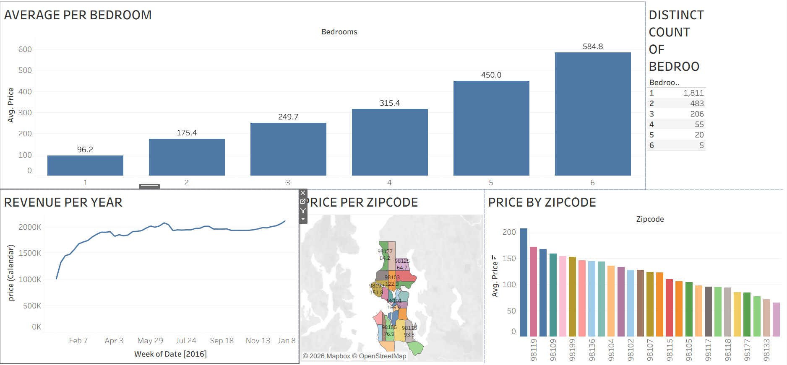

# Airbnb Listings Analysis | Tableau Dashboard

## Project Overview

This project focuses on exploring and analyzing Airbnb listing data using Microsoft Excel and Tableau. The objective is to understand listing distribution, pricing patterns, availability, and geographical trends through data analysis and interactive visualizations.

## Objectives

- Analyze Airbnb listing prices and distribution.
- Identify popular locations and neighbourhood trends.
- Examine listing availability patterns.
- Explore relationships between room types and pricing.
- Present key findings through an interactive Tableau dashboard.

## Tools & Technologies

- Microsoft Excel – Data preparation and analysis.
- Tableau – Data visualization and dashboard development.

## Project Files

| File | Description |
|---|---|
| `AIRBNB LISTINGS.twb` | Tableau workbook containing the visualizations and dashboard. |
| `Tableau Full Project.xlsx` | Excel project data and supporting analysis. |

## Key Analysis Areas

- Listing distribution by location.
- Price comparison across neighbourhoods.
- Room-type distribution.
- Availability analysis.
- Geographical patterns in Airbnb listings.

## Dashboard Preview

## Key Insights

Key findings and observations from the Tableau dashboard will be documented here.

## Author

Reno George
